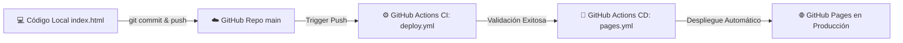
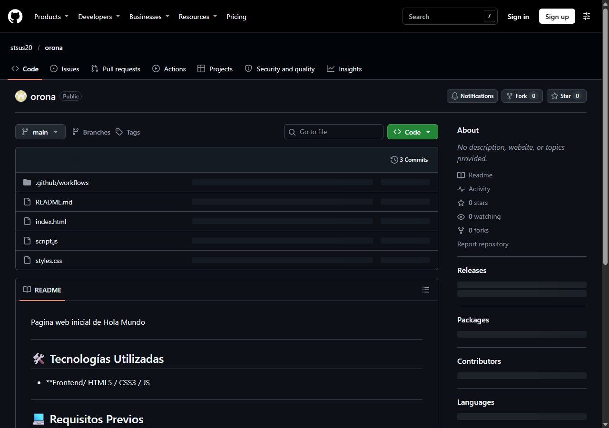
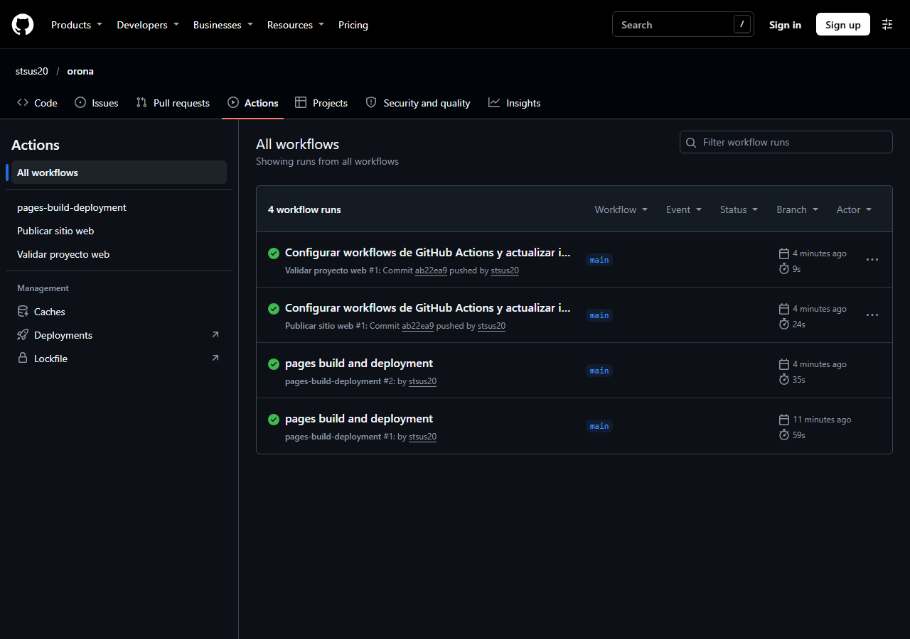
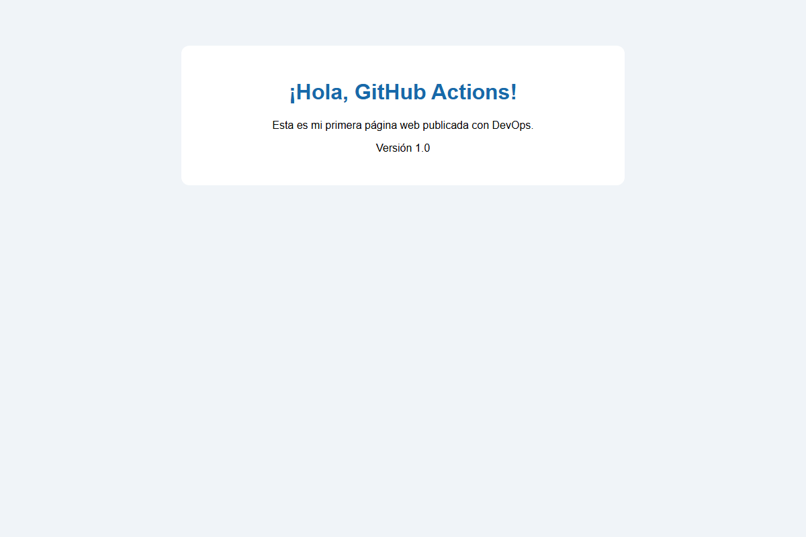
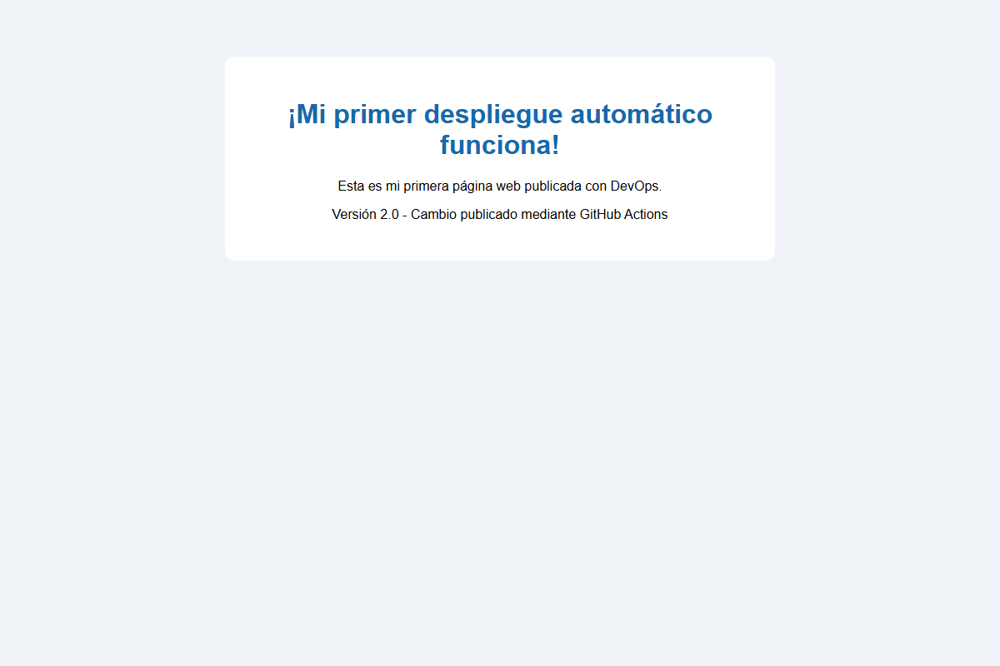
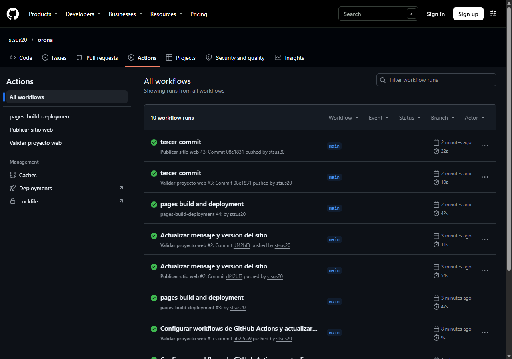
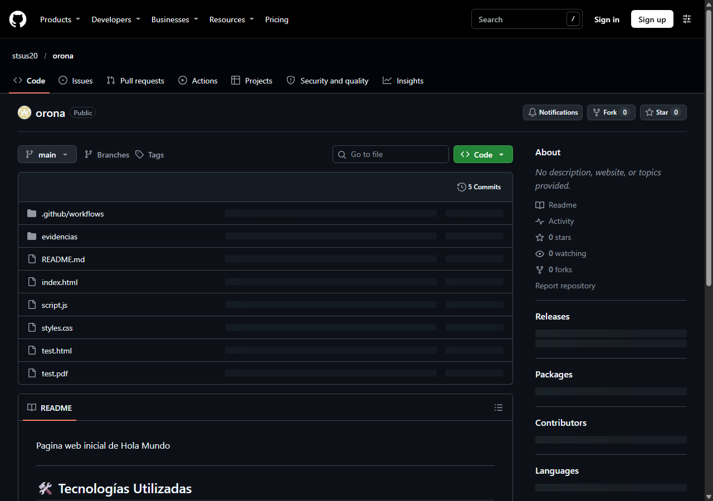

# Tutorial Práctico: Git Push + GitHub Actions

[](https://github.com/stsus20/orona/actions/workflows/deploy.yml)
[](https://github.com/stsus20/orona/actions/workflows/pages.yml)

> **Del código local a la publicación automática de una página web con GitHub Pages.**  
> Guía práctica de DevOps para estudiantes de programación y desarrollo de software.

---

## 📌 Datos de la Práctica

- **Estudiante / Usuario:** `stsus20` (`al222310374@gmail.com`)
- **Repositorio Remoto:** [https://github.com/stsus20/orona](https://github.com/stsus20/orona)
- **Sitio Web Publicado (Producción):** [https://stsus20.github.io/orona/](https://stsus20.github.io/orona/)
- **Rama Principal:** `main`

---

## 🎯 Objetivo de la Práctica

Aprender a modificar un proyecto en local, registrar y versionar los cambios con **Git**, subirlos a **GitHub**, ejecutar validaciones automáticas mediante **GitHub Actions (CI)** y desplegar de manera desatendida en **GitHub Pages (CD)**, verificando las actualizaciones en tiempo real desde el navegador.



---

## 🛠️ Desarrollo de la Práctica y Evidencias Paso a Paso

### 1. Requisitos Previos e Identidad de Git
Configuración local de las credenciales de usuario para la firma de commits:
```bash
git --version
git config --global user.name "stsus20"
git config --global user.email "al222310374@gmail.com"
```

---

### 2. Creación del Repositorio Remoto
Se creó el repositorio público en GitHub denominado `orona` sin archivos iniciales de plantilla:
- **URL remota:** `https://github.com/stsus20/orona.git`



---

### 3. Proyecto Web Local y Primer Push
Se construyó el archivo `index.html` con estructura HTML5 y estilos CSS con tarjeta centrada. Se inicializó el control de versiones y se vinculó la rama `main` al origen remoto:
```bash
git init
git branch -M main
git add .
git commit -m "Primer commit: crear pagina web"
git remote add origin https://github.com/stsus20/orona.git
git push -u origin main
```

---

### 4. Configuración de GitHub Actions para Validación (CI)
Se definió el workflow en `.github/workflows/deploy.yml` para validar automáticamente los archivos ante cada `push`:

```yaml
name: Validar proyecto web

on:
  push:
    branches:
      - main
  workflow_dispatch:

permissions:
  contents: read

jobs:
  validar:
    name: Verificar archivos del proyecto
    runs-on: ubuntu-latest
    steps:
      - name: Descargar el codigo del repositorio
        uses: actions/checkout@v4

      - name: Mostrar informacion del evento
        run: |
          echo "Workflow ejecutado correctamente"
          echo "Evento: $GITHUB_EVENT_NAME"
          echo "Rama: $GITHUB_REF_NAME"

      - name: Comprobar que existe index.html
        run: |
          test -f index.html
          echo "OK: index.html existe"

      - name: Mostrar archivos del proyecto
        run: ls -la
```

**Ejecución del pipeline en GitHub Actions:**


---

### 5. Configuración del Despliegue Continuo (CD) en GitHub Pages
En el repositorio se seleccionó en **Settings > Pages > Build and deployment > Source** la opción **GitHub Actions**.  
Posteriormente se añadió el workflow de publicación en `.github/workflows/pages.yml`:

```yaml
name: Publicar sitio web

on:
  push:
    branches:
      - main
  workflow_dispatch:

permissions:
  contents: read
  pages: write
  id-token: write

concurrency:
  group: github-pages
  cancel-in-progress: false

jobs:
  publicar:
    runs-on: ubuntu-latest
    environment:
      name: github-pages
      url: ${{ steps.deployment.outputs.page_url }}
    steps:
      - name: Descargar codigo
        uses: actions/checkout@v4
      - name: Configurar GitHub Pages
        uses: actions/configure-pages@v5
      - name: Preparar archivos del sitio
        uses: actions/upload-pages-artifact@v4
        with:
          path: .
      - name: Publicar sitio web
        id: deployment
        uses: actions/deploy-pages@v4
```

**Evidencia de la Versión 1.0 desplegada en GitHub Pages:**


---

### 6. Modificación del Código y Despliegue Automático (Versión 2.0)
Para constatar la automatización total del ciclo DevOps, se editó `index.html` actualizando el contenido a la **Versión 2.0**:
- `<h1>¡Mi primer despliegue automático funciona!</h1>`
- `<p>Versión 2.0 - Cambio publicado mediante GitHub Actions</p>`

Se enviaron los cambios al repositorio:
```bash
git status
git add index.html
git commit -m "Actualizar mensaje y version del sitio"
git push
```

**Evidencia de la Versión 2.0 actualizada en vivo en producción:**


**Evidencia de los dos Workflows completados en GitHub Actions:**


**Evidencia de la estructura final del código en GitHub:**


---

## 📋 Resumen de Comandos Git

| Comando | Función |
| :--- | :--- |
| `git init` | Inicializa un repositorio Git local en la carpeta actual. |
| `git branch -M main` | Renombra la rama principal a `main`. |
| `git add .` | Añade todos los archivos modificados al área de preparación (stage). |
| `git commit -m "mensaje"` | Guarda una instantánea de los cambios en el historial local. |
| `git remote add origin <url>` | Vincula el repositorio local con el repositorio remoto de GitHub. |
| `git push -u origin main` | Envía los commits locales hacia la rama remota y establece seguimiento. |
| `git status` | Informa sobre el estado de los archivos y cambios pendientes. |

---

## 🧠 Conceptos DevOps Aprendidos

- **Control de Versiones (Git):** Permite registrar el historial de cambios, auditar modificaciones y mantener puntos de restauración seguros del proyecto.
- **Repositorio Remoto (GitHub):** Actúa como servidor centralizado y disparador de eventos para pipelines de automatización.
- **Integración Continua (CI):** Ejecución automatizada de pruebas y comprobaciones sobre cada contribución de código antes de darla por válida.
- **Despliegue Continuo (CD):** Publicación automática del artefacto validado en el servidor o entorno de hosting (GitHub Pages) sin pasos manuales.
- **Pipeline as Code:** Toda la infraestructura y secuencia de tareas vive versionada en archivos YAML dentro de `.github/workflows/`.

---

## ✅ Lista de Comprobación Final

- [x] Git instalado e identidad de usuario configurada.
- [x] Repositorio remoto creado y conectado en GitHub.
- [x] Archivo `index.html` creado y probado localmente.
- [x] Primer commit y `git push` completados hacia `main`.
- [x] Workflow de validación (`deploy.yml`) configurado y ejecutado.
- [x] Logs de GitHub Actions inspeccionados en verde.
- [x] GitHub Pages habilitado con origen en GitHub Actions.
- [x] Workflow de despliegue (`pages.yml`) configurado y ejecutado.
- [x] Modificación de código a la Versión 2.0 enviada con `git push`.
- [x] Verificación en vivo de la página actualizada en [https://stsus20.github.io/orona/](https://stsus20.github.io/orona/).
