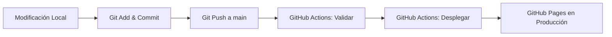

# Práctica DevOps: Git Push + GitHub Actions

> **Tutorial completado:** Del código local a la publicación automática de una página web con GitHub Pages.

---

## 🌐 Sitio Web Publicado
- **URL en producción:** [https://stsus20.github.io/orona/](https://stsus20.github.io/orona/)

---

## 📄 Entregable Oficial de la Práctica
El reporte formal con evidencias completas, capturas de pantalla de cada etapa y lista de comprobación se encuentra generado en:
- `Reporte_Practica_GitPush_GitHubActions.pdf`

---

## 🚀 Flujo de Trabajo Implementado (CI/CD)

---

## 🛠️ Estructura del Proyecto

- `index.html`: Página web principal con diseño de tarjeta centrado (Versión 2.0).
- `.github/workflows/deploy.yml`: Pipeline de validación continua (CI).
- `.github/workflows/pages.yml`: Pipeline de despliegue continuo (CD) a GitHub Pages.
- `evidencias/`: Capturas de pantalla de cada fase requerida en la práctica.
- `Reporte_Practica_GitPush_GitHubActions.pdf`: Documento PDF entregable.
